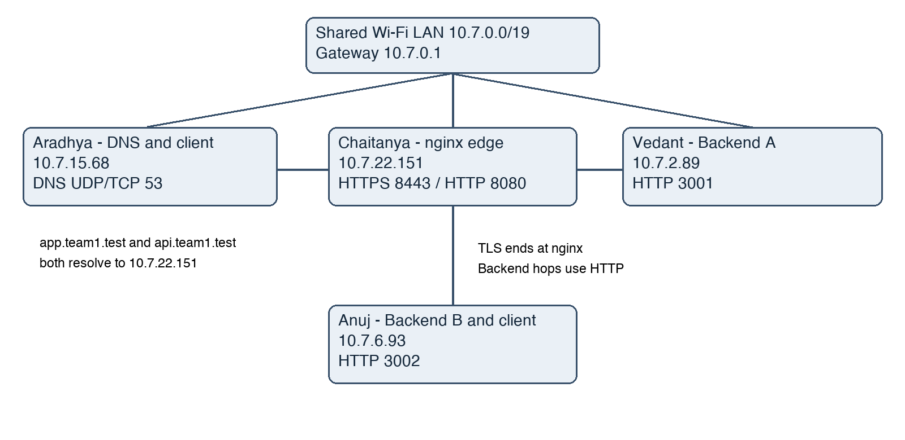

# NginX — Computer Networks Phase 1

**Section E · Build & Observe · Evidence collected 4–5 October 2026**

A private DNS service resolves `app.team1.test` and `api.team1.test` to an nginx HTTPS reverse proxy. nginx terminates TLS and distributes requests to two Python HTTP backends. The project demonstrates LAN connectivity, trusted HTTPS, round-robin load balancing, HTTP cache validation, packet analysis and controlled failures.

## Team and topology

| Member | Enrollment | Role | LAN address | Interface |
|---|---|---|---|---|
| Aradhya Tiwari | 2401010093 | DNS server and client | 10.7.15.68 | en0 (macOS) |
| Chaitanya Singh | 2401010133 | nginx edge and client | 10.7.22.151 | en0 (macOS) |
| Vedant Satbhai | 2401010500 | Backend A | 10.7.2.89:3001 | Wi-Fi (Windows) |
| Anuj Upadhyay | 2401010086 | Backend B and client | 10.7.6.93:3002 | en0 (macOS) |

All machines used subnet `10.7.0.0/19`, mask `255.255.224.0`, gateway `10.7.0.1`. Addresses are DHCP-assigned: check them before every restart. This is **three Macs and one Windows laptop**, with no cloud or VMs. The evaluator's infrastructure-category acceptance is not established.



## Repository contents

- [Report PDF](Report/CN_Phase1_Report.pdf) and [editable Word report](Report/CN_Phase1_Report.docx): original 37-page report with 30 captioned screenshots.
- [Final submission update](Guides/FINAL_SUBMISSION_UPDATE.md): changes since the original report, including updated DNS directives and required video.
- `Code/`: backend source and machine-specific launch/configuration scripts.
- `Configuration/`: final DNS configuration, deployed nginx configuration and inventory.
- `Evidence/`: screenshots, packet captures, logs and evidence index. Original troubleshooting failures are retained as history, not final success results.
- `Evidence/Final_Form/`: later configuration, client DNS, load-balancing and caching screenshots.
- [Restart and shutdown guide](Guides/RESTART_AND_SHUTDOWN.txt), [firewall notes](Guides/FIREWALL_NOTES.txt), [demo/viva guide](Guides/DEMO_AND_VIVA.txt).

## Prerequisites

Python 3 (standard library only); Windows Python launcher `py`; Homebrew `dnsmasq` on Aradhya's Mac; Homebrew `nginx` and `openssl@3` plus Python 3 on Chaitanya's Mac. Wireshark is used to inspect the supplied captures. DNS and certificate trust setup require local administrator approval.

The DNS start script uses `/opt/homebrew/opt/dnsmasq/sbin/dnsmasq`; adjust that path if Homebrew is installed elsewhere. If IPs change, update DNS listen/answer addresses, nginx upstream addresses, client DNS script and scoped firewall rules before testing.

## Run the backends

Run each command from the cloned repository on the indicated machine. Keep server terminals open.

**Vedant — Windows PowerShell:**

```powershell
cd Code/For_Windows
.\start-backend-a.cmd
```

Alternatively, from the repository root:

```powershell
py -3 Code/backend.py --name A --port 3001
```

**Anuj — macOS Terminal:**

```bash
cd Code/For_Anuj
bash start-backend-b.sh
```

Alternatively, from the repository root:

```bash
python3 Code/backend.py --name B --port 3002
```

Both backends bind on all interfaces and speak **HTTP**, not HTTPS. Endpoints: `/` and `/api/status` return backend identity with `Cache-Control: no-store`; `/cache` returns a shared representation with `public, max-age=60`, an ETag, and conditional 304 support. HEAD is supported. Review the firewall guide if Windows cannot be reached over the LAN; do not disable the entire firewall.

## Run nginx — Chaitanya

```bash
cd Code/For_Chaitanya
bash prepare-edge.sh
bash start-edge.sh
```

The generator writes absolute paths for the current checkout and supports the installed nginx HTTP/2 syntax. The archived `Configuration/nginx-deployed.conf` is evidence from the original folder, not a portable config to copy blindly.

The private TLS key is intentionally excluded. On a fresh clone this package generates a new certificate/key pair. Copy only the new `public/edge.crt` into each client's `Code/Mac_Client_Setup/edge.crt`, compare its SHA-256 fingerprint independently and update `CN_EXPECTED` in `configure-client.sh` before configuring clients. The existing client certificate is historical evidence; it must match the running edge. If only one of the certificate/key pair exists, the prepare script stops rather than overwrites it. Existing installations can keep their original working pair. Certificates expire after 30 days.

## Run DNS — Aradhya

```bash
cd Code/mac1
sudo /bin/sh ./start-dns.sh
```

Use `start-dns.sh` for normal operation. The separate wrong-record script is only for a coordinated failure demo. The final normal configuration includes:

```ini
interface=en0
listen-address=127.0.0.1,10.7.15.68
address=/app.team1.test/10.7.22.151
address=/api.team1.test/10.7.22.151
```

## Configure the three Mac clients

After confirming the public certificate matches the edge, on each Mac:

```bash
cd Code/Mac_Client_Setup
bash configure-client.sh
```

This saves original DNS settings locally, trusts the checked certificate and selects the project DNS. Keep only the private DNS server in the client resolver list during the demonstration; public DNS does not serve the private names.

## Verify by domain with certificate validation

On a client Mac:

```bash
/usr/bin/dig app.team1.test
/usr/bin/dig api.team1.test
/usr/bin/dig @8.8.8.8 app.team1.test +time=5 +tries=1
curl -v https://app.team1.test:8443
for i in 1 2 3 4 5 6; do
  echo "Request $i"
  curl --connect-timeout 5 --max-time 15 -sS -i https://app.team1.test:8443/api/status
  echo
done
curl -sI https://app.team1.test:8443/cache
```

Normal DNS answers must be `10.7.22.151`, through server `10.7.15.68`. Public DNS returned NXDOMAIN in the recorded test. HTTPS must show successful certificate verification and 200. Six recorded responses alternated B/A/B/A/B/A. A normal curl invocation does not implement a browser cache; these tests expose cache policy and conditional-response behavior.

## Failure demonstration selected for the form

Record the following on the client, with all services running:

```bash
curl --connect-timeout 5 --max-time 10 -i https://app.team1.test:8443/api/status
curl --connect-timeout 5 --max-time 10 -v https://app.team1.test:8444/api/status
curl --connect-timeout 5 --max-time 10 -i https://app.team1.test:8443/api/status
```

On 5 October, the actual sequence was **200 from B → TCP connection refused on 8444 → 200 from A**. DNS succeeded for the failed request, but TCP establishment failed before TLS/HTTP. Restoring the URL to 8443 restored access; no service configuration change was needed.

## Packet evidence and observed limitations

The saved protocol capture intentionally negotiated TLS 1.2 so the certificate exchange is visible; normal later curl negotiated TLS 1.3. Both retain certificate validation. DNS in the main capture is loopback because Aradhya is also the DNS client; separate client screenshots and peer capture prove remote DNS access. See `Evidence/Captures/protocol-annotations.txt` for exact frame numbers.

An earlier both-backends-unavailable test produced 504, rather than the brief's example 502, because a refused upstream connection was followed by a timeout. The report preserves this actual result. ICMP success does not prove application-port availability.

## Shutdown and submission

Restore each Mac's original DNS settings using its own `restore-client.sh` before stopping DNS. For this session automatic DNS restoration was requested; detailed instructions are in the restart guide. Stop only project processes via their own terminals. Do not commit client backups, private keys or generated runtime files.

The Google Form requires a **GitHub URL and a maximum five-minute / 500 MB video** with team/setup, configuration and the failure demonstration. The Drive video must be viewable by the evaluator without sign-in; a video link and final infrastructure category are separate submission items. The report and this repository do not replace the video.
